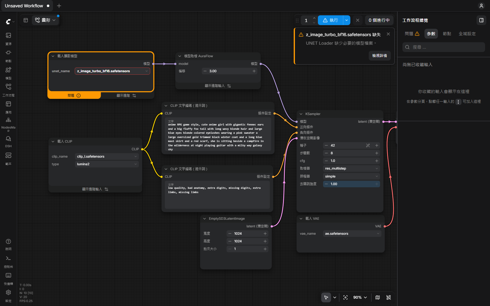
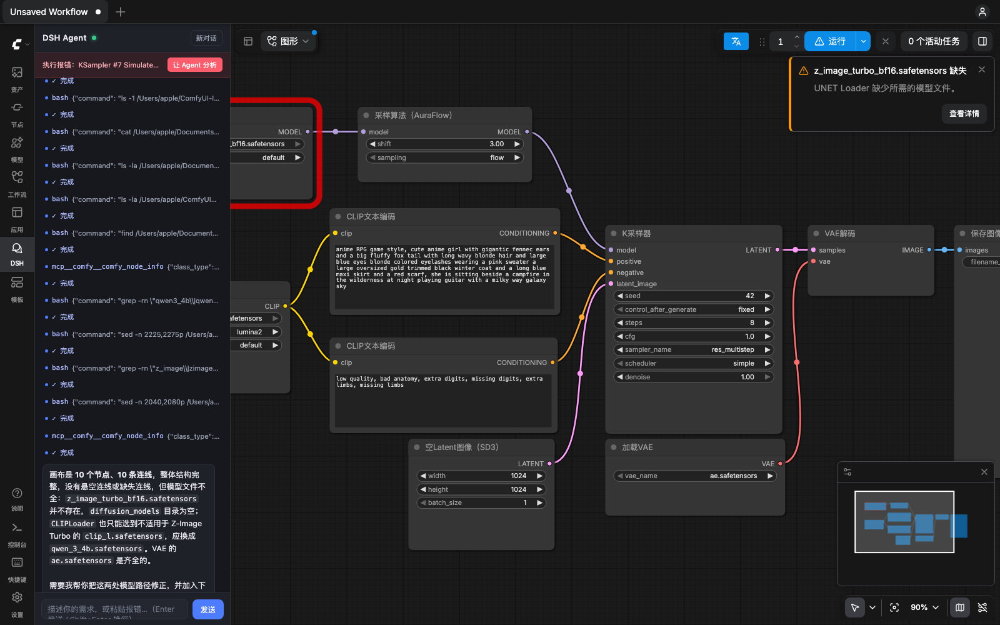
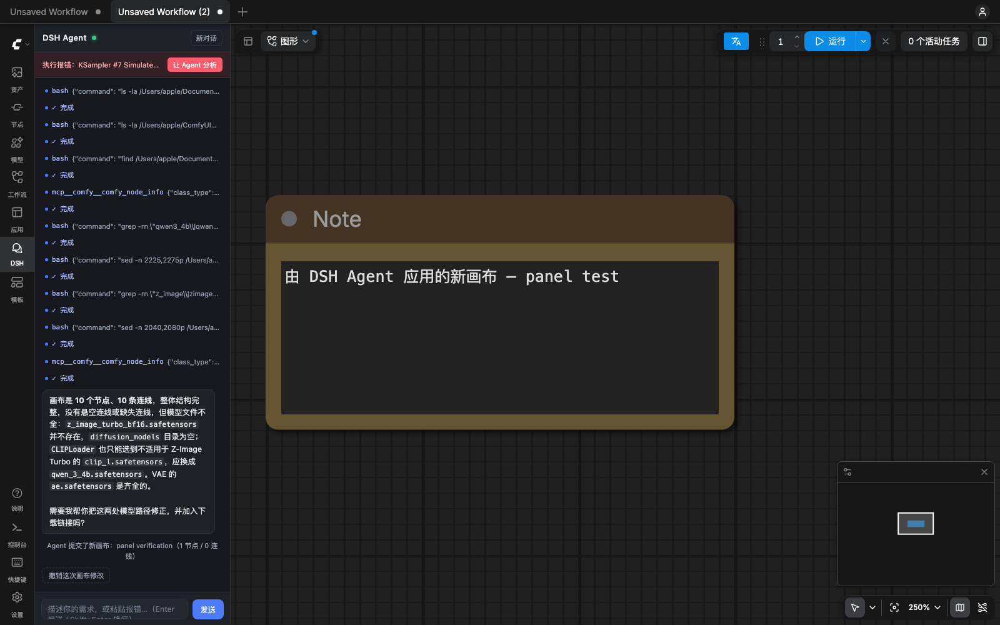

# ComfyUI × DeepSeek Harness (DSH) Agent

在 ComfyUI 的左侧栏加一个 **DSH Agent 面板**：直接和 DeepSeek Harness 对话，让它读你的画布、看执行报错、重排节点，并把新画布应用回当前工作流。

> 这是一个 ComfyUI **自定义节点**，不是 DSH 插件。方向是「在 ComfyUI 里用 DSH」，而不是「在 DSH 里操作 ComfyUI」。
> 据我们所知，目前没有同方向的公开实现——同类开源项目（`dsh-comfyui`、`dsh-comfyui-workbench` 等）都是反方向的 DSH 插件。



| 报错横幅 | Agent 应用新画布 |
| --- | --- |
|  |  |

## 实测环境

| 平台 | ComfyUI | ComfyUI frontend | DeepSeek Harness | 状态 |
| --- | --- | --- | --- | --- |
| Windows 11 | 0.46.1 | 1.59.6 | Desktop 0.2.2-rc.5 | ✅ 4 个路径全部验证（含 AMD ROCm） |
| macOS | 0.45.0 | 1.59.4 | Desktop 0.2.2-rc.5 | ✅ 原实现平台 |

## 它能做什么

| 需求 | 实现 |
| --- | --- |
| 在 ComfyUI 里和 agent 对话 | 左侧栏 `DSH` 面板，多轮上下文，支持提问卡片 |
| 对话不丢、能翻旧账 | 会话落盘到 `user/default/dsh-agent/`，面板顶部「历史会话」可切换 / 改名 / 移入回收站；重启 ComfyUI 后自动回到上次的会话 |
| 帮你看报错 | 执行出错时面板顶部出现红色横幅，「让 Agent 分析」一键把节点、异常类型、traceback 发给 agent；agent 也能用 `comfy_get_logs` 读服务端日志 |
| 理解需求后重排节点 | agent 通过 `comfy_get_graph` 读当前画布，改完后 `comfy_replace_graph` 提交，前端自动应用（可撤销） |
| 复用你的 DSH 登录 | 走 DSH 官方 SDK 协议（`--profile sdk`），复用 `~/.dsh/.credentials.yaml`，**不需要 API Key** |
| 复用官方 MCP 通道 | 通过官方 `dsh-mcp-client` 拉起本仓库的 `mcp_server.py`，工具以 `mcp__comfy__comfy_*` 形式暴露 |

## v0.2.0 新增

- **历史会话**：每个会话独立落盘（`index.json` + `sessions/<id>.jsonl`），关面板、重启 ComfyUI 都不丢；「历史会话 ▾」里可切换、改名、移到回收站，回收站里可恢复或彻底删除。多个会话可以同时存在（SDK 的 agent 活到进程退出），切换时会提示"旧会话仍在后台跑，两个一起跑抢显存"。
- **授权卡**：agent 要提权/sandbox 变更时不再只有一行小字，而是卡片——工具名、callId、理由 + 「允许一次 / 本会话总是允许 / 拒绝」。5 分钟不处理按**拒绝**结束；同会话里发新消息时，挂着的旧授权卡也按**拒绝**收尾（不会因为你说了一句话就顺手放行危险工具）。
- **询问卡支持自定义**：`ask_user_question` 的卡片除了选项，还能直接填自己的答案。
- **安全与稳定性**（一轮 5 视角对抗性代码审查后的修复）：所有 `/dsh/*` 路由校验 Host/Origin（只接受 loopback，防 DNS rebinding / CSRF）；`sessionId` 走白名单正则（防路径逃逸）；会话存储加锁、索引原子写 + 损坏自愈（从 `sessions/*.jsonl` 重建）；DSH runtime 崩溃后能重新拉起，在途请求立即失败而不是干等 30–120 秒。

详见 [`docs/PATCH-NOTES-v2.md`](docs/PATCH-NOTES-v2.md)。

## 架构

```
┌──────────────────────────── ComfyUI 前端 ────────────────────────────┐
│  DSH 侧边栏面板 (web/dsh_agent.js)                                    │
│    · 聊天 UI / 提问卡片 / 报错横幅 / 撤销                             │
│    · 每 1.8s 把 app.graph.serialize() 推给后端                        │
│    · 轮询 /dsh/poll，收到 pendingGraph 就 app.loadGraphData()         │
└───────────────────────────────┬──────────────────────────────────────┘
                                │  aiohttp (/dsh/*)
┌───────────────────────────────▼──────────────────────────────────────┐
│  ComfyUI Python 进程 (__init__.py)                                    │
│    · 画布快照 / 报错存储 / 日志 tail / object_info 查询               │
│    · 管理一个 DSH runtime 子进程 (dsh_engine.py)                      │
└───────────────────────────────┬──────────────────────────────────────┘
                                │  stdio JSON-RPC（DSH 官方 SDK 协议）
┌───────────────────────────────▼──────────────────────────────────────┐
│  dsh --profile sdk --patch <临时patch>                                │
│    · 用你已登录的 DeepSeek 账号，无需 API Key                         │
│    · 通过官方 dsh-mcp-client 拉起 mcp_server.py                       │
└───────────────────────────────┬──────────────────────────────────────┘
                                │  MCP (stdio)
┌───────────────────────────────▼──────────────────────────────────────┐
│  mcp_server.py（工具：comfy_get_context / get_graph / replace_graph  │
│                find_nodes / node_info / get_logs）                    │
│    · 再 HTTP 调回 ComfyUI 的 /dsh/* 路由                              │
└──────────────────────────────────────────────────────────────────────┘
```

关键点：**ComfyUI 画布只存在于浏览器里**，所以「读画布 / 改画布」必须由前端配合。后端保存前端推送的快照，agent 改完后前端应用，形成闭环。

## 前置条件

1. 已安装 **ComfyUI**（≥ 0.45，frontend 1.59.x；Desktop 或 portable 均可）。
2. 已安装 **DeepSeek Harness Desktop**，并**已在应用内登录** DeepSeek 账号。
3. ComfyUI 用的 Python ≥ 3.10（仅用标准库 + ComfyUI 自带的 `aiohttp`，**无需 pip install**）。

## 安装

### Windows

```powershell
# 1) 找到你的 ComfyUI 目录（Comfy Desktop 默认在下面这个位置）
$comfy = "$env:USERPROFILE\ComfyUI-Installs\ComfyUI\ComfyUI"

# 2) 把本仓库整个文件夹复制进 custom_nodes（Windows 上别用符号链接，需要管理员/开发者模式）
Copy-Item -Recurse .\comfyui-dsh-agent "$comfy\custom_nodes\dsh-agent"

# 3) 重启 ComfyUI（Comfy Desktop：退出后重新打开）
```

重启后左侧栏（「NodesManager」和「模板」之间）出现 `DSH` 图标。

### macOS

```bash
# 假设 ComfyUI 在 ~/Documents/ComfyUI
cp -R ./comfyui-dsh-agent ~/Documents/ComfyUI/custom_nodes/dsh-agent

# 或者用软链（macOS 上没问题）
ln -sfn "$PWD/comfyui-dsh-agent" ~/Documents/ComfyUI/custom_nodes/dsh-agent
```

然后重启 ComfyUI。

### 路径自动探测

`dsh_engine.py` 会按平台自动查找 DSH 的 Electron 可执行文件和 `bin.js`：

| 平台 | 自动探测的路径 |
| --- | --- |
| Windows | `%LOCALAPPDATA%\Programs\DeepSeek Harness\DeepSeek Harness.exe` + `...\resources\app.asar\dsh\node_modules\@deepseek-ai\dsh` |
| macOS | `/Applications/DeepSeek Harness.app/Contents/MacOS/DeepSeek Harness` + `.../Contents/Resources/app.asar/dsh/node_modules/@deepseek-ai/dsh` |
| 其他 | `Program Files` / `ProgramW6432` 下的 DeepSeek Harness |

装在非标准位置时，用环境变量覆盖即可（见下）。

## 配置（可选，通过环境变量传给 ComfyUI 进程）

| 变量 | 默认 | 说明 |
| --- | --- | --- |
| `DSH_COMFY_PROVIDER` | `deepseek-account` | DSH 模型路由 |
| `DSH_COMFY_MODEL` | `deepseek-flash` | 模型名 |
| `DSH_COMFY_EFFORT` | `high` | reasoning effort |
| `DSH_NODE_EXECUTABLE` | 自动探测 | Electron 可执行文件绝对路径 |
| `DSH_INSTALL_DIR` | 自动探测 | dsh CLI 包目录（含 `lib/bin.js`） |

## 使用

1. 打开一个工作流（画布内容会自动同步给后端）。
2. 点左侧 `DSH`。
3. 直接说需求，例如：
   - 「我这个工作流为什么报错？」
   - 「帮我看看现在画布上缺什么」
   - 「把采样器换成 dpmpp_2m，步数 30」
   - 「在这条文生图后面加一个 2x 放大，模型用本机已有的」
4. 报错时点顶部红色横幅的「让 Agent 分析」。
5. agent 提交新画布后，面板会出现「Agent 提交了新画布…」和「撤销这次画布修改」。

## 调试

把端口换成你自己 ComfyUI 的端口（Desktop 的 `portConflict: auto` 可能在 8188/8189 之间浮动）：

```bash
curl -s http://127.0.0.1:8188/dsh/status     # 引擎状态
curl -s http://127.0.0.1:8188/dsh/debug      # runtime stderr 尾部
curl -s http://127.0.0.1:8188/dsh/state      # agent 看到的全部上下文
curl -s "http://127.0.0.1:8188/dsh/logs?lines=200"
```

面板显示「DeepSeek Harness runtime 启动失败」时：

1. 确认 DSH Desktop 已安装、已登录。
2. 看 `/dsh/debug` 里的 `stderr`。
3. 手动验证 CLI 能起来：

```powershell
# Windows
$dsh = "$env:LOCALAPPDATA\Programs\DeepSeek Harness"
$env:ELECTRON_RUN_AS_NODE = "1"
& "$dsh\DeepSeek Harness.exe" "$dsh\resources\app.asar\dsh\node_modules\@deepseek-ai\dsh\lib\bin.js" --profile sdk --help
```

```bash
# macOS
ELECTRON_RUN_AS_NODE=1 "/Applications/DeepSeek Harness.app/Contents/MacOS/DeepSeek Harness" \
  "/Applications/DeepSeek Harness.app/Contents/Resources/app.asar/dsh/node_modules/@deepseek-ai/dsh/lib/bin.js" \
  --profile sdk --help
```

## 安全说明（请先读）

- **Agent 的审批请求会自动放行**（`allowed-once`），面板不会弹审批框。也就是说，agent 在你本机执行工具时不需要你逐次确认。
- 因此请只在**本机回环**（`127.0.0.1`）上开 ComfyUI，不要用 `--listen 0.0.0.0` 暴露到局域网/公网；ComfyUI 本身没有鉴权。
- 想让 agent 不能跑某些工具，改 `dsh_engine.py` 的 `_handle_server_request`，把自动放行换成拒绝或人工确认。

## 已知限制

- **画布应用是整体替换**，不是逐节点增量编辑；复杂的多步编辑会一次性刷新画布。有撤销。
- agent 默认只看到画布摘要（每个节点一行），完整 JSON 需要它主动调 `comfy_get_graph`。
- 依赖 DSH Desktop 的安装布局（asar 内的 `bin.js`）。asar 内部路径无法被 `os.stat` 检查，所以探测只校验 exe 是否存在，`bin.js` 交给 Electron 去读。
- `--profile sdk` 首次启动会在 `~/.dsh/profiles/sdk` 生成 profile（或直接用合成配置），并复用 `~/.dsh/.credentials.yaml` 的登录态。
- Windows 上如果 ComfyUI 启动报 `TypeError: init() got an unexpected keyword argument 'simple_vram_headroom'`，说明用错了 Python 解释器（`standalone-env` 与 `.venv` 的 `comfy-aimdo` 版本不一致）。用 ComfyUI 自带 venv 的 `python.exe` 启动即可，与本节点无关。

## 和 ComfyUI 官方 agent / Comfy MCP 的关系

- **Comfy Agent**（界面内置）：Cloud 已 GA，本地 Desktop「coming soon」；模型固定为 Claude Opus，按 token 计费，没有开放第三方模型接入点。
- **Comfy MCP**（官方开源）：`comfy-mcp` 本地 stdio server，走 `comfy-cli`，工具面向 **workflow JSON 文件**（run/validate/search），不能操作当前画布，也没有内嵌聊天 UI。
- 本项目：用 DSH 官方 SDK 协议当 agent 运行时、用官方 `dsh-mcp-client` 挂 MCP 工具，自己补上「ComfyUI 面板 + 实时画布」这段官方还没开放的能力。

## 文件

| 文件 | 作用 |
| --- | --- |
| `__init__.py` | ComfyUI 自定义节点：路由、画布/报错存储、runtime 生命周期 |
| `dsh_engine.py` | 极简 DSH SDK 客户端（stdio JSON-RPC、事件流、审批/提问、跨平台路径探测） |
| `mcp_server.py` | MCP stdio server，暴露 `comfy_*` 工具 |
| `web/dsh_agent.js` | 侧边栏面板（含「重开面板不丢上下文」修复） |
| `web/css/dsh_agent.css` | 面板样式 |
| `CHANGELOG.md` | 相对初始版本的改动记录（Windows 适配 + 面板上下文修复） |

## English quickstart

A ComfyUI custom node that adds a **DeepSeek Harness chat sidebar** inside ComfyUI. It talks to the DSH Agent runtime over the official SDK stdio protocol (reusing your DSH desktop login — no API key), and exposes `comfy_get_graph` / `comfy_replace_graph` / `comfy_find_nodes` / `comfy_node_info` / `comfy_get_logs` / `comfy_get_context` through the official `dsh-mcp-client`.

Install: copy this folder to `ComfyUI/custom_nodes/dsh-agent`, restart ComfyUI, click `DSH` in the left sidebar. Windows and macOS paths are auto-detected; override with `DSH_NODE_EXECUTABLE` / `DSH_INSTALL_DIR`.

> Security: tool approvals are auto-allowed (`allowed-once`). Run ComfyUI on loopback only.

## License

MIT — see [LICENSE](LICENSE).
